# Architecture

The shape of the system. [`HOW-IT-WORKS.md`](HOW-IT-WORKS.md) is the same story
in code — the checkpoint commit protocol, the Argo retry config and the injection,
with the logs each one produced. [`DEMO.md`](DEMO.md) is the runbook (what to
type), [`PRODUCTION-CHECKLIST.md`](PRODUCTION-CHECKLIST.md) the demo-to-production
deltas (what to change before you rely on it).

**What it does:** a multi-GPU training run survives losing its node, resuming
from the last durable checkpoint instead of restarting.

Where a fact lives in code, this file links to it rather than restating it. A
pinned chart version or a CPU request copied into prose is a future
contradiction.

---

## 1. A run, end to end

```mermaid
flowchart TB
    subgraph local["your laptop"]
        MK["make run<br/>substitutes IMAGE, S3_URI, WANDB_RUN"]
    end

    subgraph system["system node group -- 2x 4-vCPU on-demand, always on"]
        AWF["Argo controller"]
        DS["dataset<br/>8 shards"]
        TOK["tokenizer"]
    end

    subgraph gpu["GPU node -- 8 GPUs, Karpenter-provisioned by ATTRIBUTE"]
        TR["train<br/>torchrun --nproc_per_node=8"]
    end

    S3[("S3<br/>runs/d12-&lt;id&gt;/")]
    ECR[("ECR")]

    MK --> AWF
    AWF --> DS --> TOK --> NC["NodeClaim<br/>(no node tolerates nvidia.com/gpu yet)"]
    NC -->|"~90s"| TR
    ECR -.->|"image pull ~3s"| TR
    DS & TOK & TR <-->|"sync_down / sync_up"| S3
    TR -->|"on success"| DONE(["step 400"])

    TR -.->|"SIGTERM"| DRAIN["on_term: drain + final sync_up, exit 1"]
    DRAIN -.->|"Argo retryStrategy"| NC

    style gpu fill:#2d1b00,stroke:#ff9900
    style DRAIN fill:#3d0000,stroke:#ff4444
```



The DAG is three nodes: [`k8s/workflow-base-train.yaml`](../k8s/workflow-base-train.yaml).
Scope is deliberately only the path to `base_train`, not nanochat's full 8
stages — `base_train` is the only stage with upstream `--resume-from-step`
support and the only one long enough to be worth interrupting.

`dataset` and `tokenizer` request no GPU, so they run on the system group and
never occupy a $30/hr node. They are also the cheap canary: both the Prometheus
metric expressions and the W&B secret read are exercised there, ~2 min in, so a
config error fails the DAG before Karpenter launches anything expensive.

---

## 2. Where state lives

**S3 is the only durable store. Node disk is scratch, because the node is what
disappears.** The GPU node's 7.6 TB of local NVMe is RAID0'd into
ephemeral-storage (the `gpu_node_class` resource in
[`karpenter.tf`](../terraform/live/eks/karpenter.tf))
purely as a staging area between `torch.save` and the upload.

**A checkpoint step is ten files and 2.0 GiB:** `model_NNNNNN.pt` (756 MiB) and
`meta_NNNNNN.json` from rank 0, plus `optim_NNNNNN_rank{0..7}.pt` (157.6 MiB
each) written concurrently by all eight ranks.

**The commit protocol — the invariant that makes a resume safe.** Every local
artifact is written to a private temporary file, flushed, and atomically renamed.
After all optimizer ranks cross a distributed barrier, rank 0 publishes
`meta_*.json` as the local **commit marker**. The uploader snapshots only those
committed steps, uploads their exact model and optimizer rank set, then uploads
metadata strictly last
(the sibling nanochat checkout's `checkpoint_manager.py`; and
[`entrypoint.sh`](../docker/entrypoint.sh) `sync_up`). So:

> **"`meta_NNNNNN.json` is present" implies the model and all eight optimizer
> shards `0..7` already landed.** That is the safe read predicate on both local
> disk and S3, and
> `complete_step()` is the single function that enforces it — shared between the
> local-disk and S3 callers on purpose, because two copies of this rule drifting
> apart would mean a resume picking a half-present step and every retry dying
> identically in `torch.load`.

**A resume downloads one step, not all of them.** Measured on a finished
400-step run: the prefix is 32.5 GiB, of which 31.5 GiB is 16 retained
checkpoints. A resume reads exactly one, so `sync_down` syncs with
`--exclude 'base_checkpoints/*'` and then copies the ten files of the newest
complete step — ~3.0 GiB. The old flat sync grew linearly with
`num-iterations` while the benefit stayed flat; at 2000 iterations it was 160
GiB, longer to download than the whole recovery it was part of.

**Prefix layout** under the artifacts bucket defined in
[`foundation/main.tf`](../terraform/live/foundation/main.tf):

| Prefix | Written by | Read by |
|---|---|---|
| `runs/d12-<id>/base_data_climbmix/` | `dataset` stage | `train` |
| `runs/d12-<id>/tokenizer/` | `tokenizer` stage | `train` |
| `runs/d12-<id>/base_checkpoints/d12/` | `train`, every `--save-every` | the next attempt |
| `runs/d12-<id>/.preflight` | every stage at startup | nothing — it exists to *prove write access* before a GPU-hour is spent |
| `argo-logs/<workflow>/<pod>/` | Argo's `wait` sidecar | `make timeline`, the Argo UI |

Each `make run` gets its own `RUN_ID`. With a fixed prefix the second run finds
step 400 already there and "resumes" straight to COMPLETE — which looks like a
pass and proves nothing (see the `RUN_ID` definition in [`Makefile`](../Makefile)).

---

## 3. The interruption path

It spans three files. In order:

```
scripts/inject-termination.sh
  └─ writes an "EC2 Spot Instance Interruption Warning" event
     directly to Karpenter's SQS interruption queue
          │
          │  Not AWS FIS: its aws:ec2:send-spot-instance-interruptions action
          │  targets aws:ec2:spot-instance, and the demo pins reserved
          │  capacity so its timings are reproducible. The queue and its
          │  EventBridge rules are real, created by the Karpenter submodule
          │  -- only the event's origin is synthetic.
          ▼
Karpenter controller  (terraform/live/eks/karpenter.tf)
  └─ taints the node, cordons it, deletes the pod
     NodePool terminationGracePeriod = 5m
          ▼
kubelet sends SIGTERM to every container in the pod
     pod terminationGracePeriodSeconds = 110  (workflow-base-train.yaml podSpecPatch)
          ▼
entrypoint.sh  on_term()
  ├─ phase sigterm
  ├─ kills the periodic uploader FIRST (two concurrent syncs would race and
  │  could publish a marker for a step whose shards are still uploading)
  ├─ SIGTERMs torchrun, waits up to 25s for an in-flight torch.save
  ├─ final sync_up  -- the one that must fit in the grace period
  ├─ phase drain_done <step>
  └─ exit 1
          ▼
Argo retryStrategy  (limit 10, retryPolicy: Always)
  └─ creates a FRESH pod; nothing tolerates nvidia.com/gpu, so it is Pending
          ▼
Karpenter provisions a replacement NodeClaim -> new 8-GPU node
          ▼
entrypoint.sh on the new pod
  └─ sync_down -> complete_step() -> "RESUMING from step N" -> torchrun --resume-from-step=N
```

A real Spot interruption warning arrives as the same message on the same queue,
so every box above is unchanged on Spot — see [`DEMO.md`](DEMO.md) for what to
change to run it there.

**The one thing that is never retried** is a config error. The entrypoint exits
64 (`EX_USAGE`) when it cannot do what it was asked — today only an unreadable
W&B secret — and the `retryStrategy` `expression` excludes that code. Otherwise
one empty secret buys ten GPU nodes and ~8h of exponential backoff. A drained
pod has no exit code at all, so the interrupt path still matches and retries.

**What recovery looks like**, injected at step 107: SIGTERM 14:40:25 →
replacement NodeClaim 14:41:26 → `pod_start` 14:43:48 → `RESUMING from step 125`
14:44:02 → first step done 14:44:58. **~4m33s from injection to resumed
training.** Checkpoints are unbroken 25→400 with no gap at 125: the 110s grace
period let the dying pod finish training 107→125 and commit it, so nothing was
lost beyond the drain itself.

---

## 4. Identity and trust boundaries

**EKS Pod Identity only.** No IRSA, no Kubernetes Secrets holding AWS
credentials, no Secrets Store CSI driver. Four service accounts, three roles:

| Namespace / SA | Role | Can reach |
|---|---|---|
| `default` / `argo-workflow` | `-trainer` (the `trainer_s3` policy in [`karpenter.tf`](../terraform/live/eks/karpenter.tf) and `trainer_wandb_secret` in [`observability.tf`](../terraform/live/eks/observability.tf)) | the artifacts bucket; `GetSecretValue` on the W&B secret |
| `argo` / `argo-workflows-server` | `-trainer` | the same, so the UI can open archived logs itself |
| `monitoring` / `…-prometheus`, `…-grafana` | `-amp` (the monitoring policy in [`amp.tf`](../terraform/live/eks/amp.tf)) | `aps:RemoteWrite` + query on one workspace ARN |
| `kube-system` / `karpenter` | module-managed | EC2, the interruption queue |

Deliberately *not* shared: the monitoring role has no access to the checkpoint
write path, and S3 access hangs off a dedicated role rather than the node role,
which would grant it to every pod on the node.

**Credentials are injected at pod ADMISSION.** A pod created before its
association exists never gets them and nothing retrofits a running pod. This is
not a detail — pointing a `depends_on` the wrong way round made `argo-server`
come up credential-less on every single apply, with a green plan. The W&B key is
read from Secrets Manager at container start rather than mirrored into etcd, so
it never goes stale against the secret it came from.

The cluster endpoint is currently public with no CIDR allowlist — see
[`PRODUCTION-CHECKLIST.md`](PRODUCTION-CHECKLIST.md).

---

## 5. Two Terraform roots, split by lifetime

| | [`foundation/`](../terraform/live/foundation) | [`eks/`](../terraform/live/eks) |
|---|---|---|
| **Lifetime** | survives teardown | destroyed after reviewing and applying the plan from `make down-cluster` |
| **Holds** | VPC, artifacts bucket, ECR repo, S3 gateway endpoint, AMP workspace, W&B secret | the cluster, Karpenter, Argo, kube-prometheus-stack, DCGM, every IAM role and Pod Identity association |
| **Costs when idle** | ~$0.05/hr (NAT gateway) | nothing, once destroyed |

**To stop paying without losing work, destroy `eks`.** Everything a past run
produced — checkpoints, archived logs, the metric series, the W&B key — is in
`foundation` or in AMP.

The split is by *what must outlive a teardown*, and getting it wrong is silent:
a metrics workspace in the disposable root means "durable until the next
teardown", and a secret there is re-forgotten on every rebuild. Both were
originally in the wrong place.

The two roots are wired by **AWS tag and name discovery, never
`terraform_remote_state`** — subnets by `karpenter.sh/discovery`
([`eks/main.tf`](../terraform/live/eks/main.tf)), the AMP workspace by alias
([`amp.tf`](../terraform/live/eks/amp.tf)), the secret by name. So `eks` is
coupled to foundation's *resources*, not to its output layout, and a `check`
block names the missing prerequisite instead of letting a plan fail cryptically.
State is keyed by region, so `REGION` is a real choice and not a lie.

---

## 6. Observability — four paths, by what each survives

| Signal | Path | Survives |
|---|---|---|
| Phase boundaries (`PHASE` JSON on stdout) | pod stdout → Argo `wait` sidecar → `argo-logs/` in S3 → `make timeline` | the node, the pod, the Workflow object |
| GPU power/util, node boot, drain, Argo durations | DCGM + Karpenter + Argo → Prometheus → remote-write → **AMP** | apply the reviewed plan from `make down-cluster` |
| The DAG, retries, per-attempt logs | Argo UI (`make argo-ui`) | until `podGC`, then S3 for the logs |
| Loss curve | W&B | everything |

Local Prometheus is a scrape-and-forward buffer, not an archive: it lives in the
disposable root. AMP is the archive, and a rebuilt cluster's Grafana finds the
same workspace by alias and re-attaches to it.

`make timeline` turns the wrapper's `PHASE` lines into node boot, image pull,
restore, train launch, drain and GPU-idle time in dollars. Historical logs may
also contain optional nanochat-side `first_step` and `ckpt_saved` events, which
add exact compile/startup and local-save-to-S3 rows. The current lean fork omits
those hooks and the table marks those rows unavailable. Its shelf life is the
Workflow object, since it also reads
`status.nodes[].startedAt` and nothing here archives Workflow objects (that
needs Postgres, deliberately omitted). The two numbers that must outlive it —
total train duration and retries consumed — are published from the workflow spec
as Prometheus metrics instead, queryable as `argo_workflows_nanochat_*`.

**Placement is enforced structurally, not by convention.** The GPU NodePool's
`nvidia.com/gpu` taint keeps Prometheus and Grafana off the $30/hr nodes,
because they have no toleration. DCGM is the one deliberate exception.

---

## 7. Cost shape

It drives every design choice above.

| | Rate |
|---|---|
| an 8-GPU node (measured on `g6e.48xlarge`, 8× L40S) | ~$30/hr | <!-- portable-ok: priced from a measured run; the rate is meaningless without naming what was measured -->
| Two-slot ODCR | ~$60/hr, **billed from creation whether or not anything runs** |
| `foundation` idle | ~$0.05/hr |

Hence: GPU work is confined to one DAG node; the prep stages are CPU-only;
`consolidationPolicy: WhenEmpty` with `consolidateAfter: 2m` reclaims the node
as soon as the workflow ends but never disrupts a running pod; `expireAfter:
24h` is the backstop. The ODCR is the one thing not under Terraform — an
open-ended reservation has no expiry to save you, which is why `make odcr` shows
what it is costing per day.
